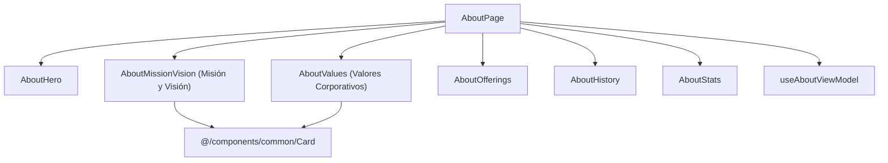

# Software Design Document (SDD) — US-15 (KAN-15)
## Misión, Visión y Valores de la Empresa en el Portal Landing

| Metadato | Valor |
|---|---|
| **Historia de Usuario** | US-15 / KAN-15 ("Como visitante quiero leer la misión y visión de la empresa para conocer sus propósitos y valores") |
| **Épica** | KAN-14 ([Landing] Sobre nosotros y ayuda) |
| **Portal** | Landing (`src/modules/landing/features/about`) |
| **Fecha de Especificación** | 2026-10-18 |
| **Estado** | Aprobada para Implementación |
| **Requerimientos Relacionados** | RF-01 (Landing Page), RNF-01 (Rendimiento), RNF-04 (Usabilidad), RNF-05 (Tema Dinámico), RNF-08 (Accesibilidad WCAG AA) |

---

### 1. Resumen y Propósito

Enriquecer la página de información de la empresa (`AboutPage`) bajo `/about` (`ROUTE_PATH.LANDING.ABOUT`) con una sección dedicada, accesible y visualmente atractiva para exponer la Misión, Visión y Valores Corporativos de Booking System.

Permite a los visitantes, potenciales suscriptores y clientes finales comprender los principios rectores, el compromiso ético y la dirección estratégica de la plataforma, consolidando la confianza institucional y la identidad de marca de la SaaS.

---

### 2. Criterios de Aceptación Medibles

* **AC-KAN-15-01 [Happy Path - Visualización de Misión de la Empresa]:** Dado que un visitante accede a `/about`, visualiza la declaración de Misión de la plataforma en una tarjeta destacada (`Card`) con icono representativo, título y propósito institucional.
* **AC-KAN-15-02 [Happy Path - Visualización de Visión de la Empresa]:** En la misma página, visualiza la declaración de Visión a futuro en una tarjeta estructurada destacando las metas de liderazgo y evolución tecnológica.
* **AC-KAN-15-03 [Happy Path - Visualización de Valores Corporativos]:** Se presenta una sección de Valores Corporativos desglosando los 4 pilares fundamentales (Innovación, Transparencia, Confiabilidad y Enfoque en el Usuario) con títulos, iconos e interpretaciones legibles.
* **AC-KAN-15-04 [Accesibilidad WCAG AA y Theming (RNF-05, RNF-08)]:**
  - Encabezados estructurados con roles semánticos (`h2`, `h3`).
  - Uso exclusivo de tokens semánticos de Tailwind v4 (`bg-card`, `text-card-foreground`, `text-muted-foreground`, `border-border`).
  - Responsive y accesible en dispositivos móviles (360 px) sin scrolls indeseados.
* **AC-KAN-15-05 [Internacionalización]:** Textos centralizados en `src/i18n/locales/{es,en}/landing.json` bajo `about.mission.*`, `about.vision.*` y `about.values.*` con paridad total y ordenación A-Z.

---

### 3. Matriz de Fronteras de Equipo

| Recurso / Módulo | Estado | Permiso |
|---|---|---|
| `docs/specs/2026-10-18-US-15-mision-vision-landing.md` | Nuevo archivo | **Permitido (Creador)** |
| `src/modules/landing/features/about/components/AboutMissionVision.tsx` | Nuevo componente | **Permitido (Creador)** |
| `src/modules/landing/features/about/components/AboutValues.tsx` | Nuevo componente | **Permitido (Creador)** |
| `src/modules/landing/features/about/AboutPage.tsx` | Actualización con nuevas secciones | **Permitido (Creador)** |
| `src/modules/landing/features/about/hooks/useAboutViewModel.ts` | Extensión con misión, visión y valores | **Permitido (Creador)** |
| `src/modules/landing/features/about/models/about.model.ts` | Extensión de tipos de valores y principios | **Permitido (Creador)** |
| `src/modules/landing/features/about/constants/about.constants.ts` | Constantes ordenadas A-Z | **Permitido (Creador)** |
| `src/modules/landing/features/about/tests/**` | Pruebas unitarias e integración con POM | **Permitido (Creador)** |
| `src/i18n/locales/{es,en}/landing.json` | Claves bajo `about.mission`, `about.vision`, `about.values` | **Permitido (Aditivo)** |
| Otros módulos | Fuera de alcance | **PROHIBIDO MODIFICAR** |

---

### 4. Arquitectura de Componentes y Estado (MVVM)

---

### 5. Plan de Verificación de Calidad

1. **Prettier:** `npm run format:check` con 0 inconsistencias de formato.
2. **TypeScript:** `npm run typecheck` (`tsc -b --noEmit`) sin errores de compilación ni tipos `any`.
3. **ESLint:** `npm run lint` con 0 errores y 0 advertencias.
4. **Vitest:** Pruebas unitarias y de integración cubriendo el 100% de `AC-KAN-15-01` a `AC-KAN-15-05`.
