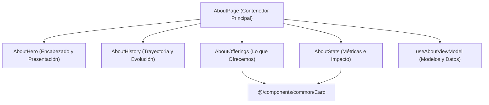

# Software Design Document (SDD) — US-16 (KAN-16)
## Información Detallada sobre la Empresa en el Portal Landing

| Metadato | Valor |
|---|---|
| **Historia de Usuario** | US-16 / KAN-16 ("Como visitante quiero acceder a información detallada sobre la empresa para comprender mejor su trayectoria y lo que ofrecen") |
| **Épica** | KAN-14 ([Landing] Sobre nosotros y ayuda) |
| **Portal** | Landing (`src/modules/landing/features/about`) |
| **Fecha de Especificación** | 2026-10-18 |
| **Estado** | Aprobada para Implementación |
| **Requerimientos Relacionados** | RF-01 (Landing Page), RNF-01 (Rendimiento), RNF-04 (Usabilidad), RNF-05 (Tema Dinámico), RNF-08 (Accesibilidad WCAG AA) |

---

### 1. Resumen y Propósito

Proveer una página pública y accesible (`AboutPage`) bajo la ruta `/about` (`ROUTE_PATH.LANDING.ABOUT`) que permita a los visitantes conocer a profundidad la empresa Booking System: su trayectoria histórica, evolución, capacidades tecnológicas y propuesta de valor ("Lo que ofrecemos"), acompañada de indicadores de impacto y métricas clave de la plataforma.

Esta página sienta las bases modulares del dominio "Sobre Nosotros" (`src/modules/landing/features/about`), permitiendo su posterior enriquecimiento atómico en KAN-15 (Misión, Visión y Valores).

---

### 2. Criterios de Aceptación Medibles

* **AC-KAN-16-01 [Happy Path - Visualización de Información General y Trayectoria]:** Dado que un visitante accede a `/about`, visualiza el encabezado principal con la descripción general de Booking System y la sección de historia/trayectoria describiendo su evolución y origen.
* **AC-KAN-16-02 [Happy Path - Propuesta de Valor / Lo que Ofrecemos]:** En la misma página, se presenta una cuadrícula estructurada con las soluciones y capacidades que ofrece la plataforma (gestión de citas 24/7, analítica para negocios, soporte multi-tenant y recordatorios automáticos).
* **AC-KAN-16-03 [Happy Path - Métricas e Indicadores de Impacto]:** Se despliegan tarjetas semánticas (`Card`) con métricas de servicio (citas procesadas, tiempo de actividad del sistema, satisfacción) para consolidar confianza con el visitante.
* **AC-KAN-16-04 [Happy Path - Enrutamiento y Slug Reservado]:** La página responde bajo `ROUTE_PATH.LANDING.ABOUT = "/about"` y el término `about` se incluye en `RESERVED_BUSINESS_SLUG` para evitar colisiones con identificadores de negocios suscritos.
* **AC-KAN-16-05 [Accesibilidad WCAG AA y Theming (RNF-05, RNF-08)]:**
  - Jerarquía clara de encabezados (`h1`, `h2`, `h3`).
  - Contraste cromático conforme a WCAG AA utilizando tokens semánticos (`bg-background`, `bg-card`, `text-foreground`, `text-muted-foreground`, `border-border`).
  - Maquetación adaptativa fluida sin desbordamiento horizontal en pantallas estrechas (360 px).
* **AC-KAN-16-06 [Internacionalización]:** Textos centralizados en `src/i18n/locales/{es,en}/landing.json` bajo la clave `about.*`, con paridad estricta y ordenación alfabética de propiedades.

---

### 3. Matriz de Fronteras de Equipo

| Recurso / Módulo | Estado | Permiso |
|---|---|---|
| `docs/specs/2026-10-18-US-16-informacion-empresa-landing.md` | Nuevo archivo | **Permitido (Creador)** |
| `src/modules/landing/features/about/AboutPage.tsx` | Nuevo componente | **Permitido (Creador)** |
| `src/modules/landing/features/about/components/**` | Nuevos subcomponentes (`AboutHero`, `AboutHistory`, `AboutOfferings`, `AboutStats`) | **Permitido (Creador)** |
| `src/modules/landing/features/about/hooks/useAboutViewModel.ts` | Hook MVVM | **Permitido (Creador)** |
| `src/modules/landing/features/about/models/**` | Tipos e interfaces con JSDoc | **Permitido (Creador)** |
| `src/modules/landing/features/about/tests/**` | Pruebas unitarias e integración con POM | **Permitido (Creador)** |
| `src/constants/routes/RoutePath.constants.ts` | Adición de `ROUTE_PATH.LANDING.ABOUT` | **Permitido (Aditivo)** |
| `src/domain/business/BusinessSlug.constants.ts` | Adición de `ABOUT: "about"` | **Permitido (Aditivo)** |
| `functions/src/shared/constants/BusinessSlug.constants.ts` | Sincronización de slug reservado | **Permitido (Aditivo)** |
| `src/modules/landing/landing.routes.tsx` | Registro de ruta `/about` | **Permitido (Aditivo)** |
| `src/i18n/locales/{es,en}/landing.json` | Claves bajo `about.*` | **Permitido (Aditivo)** |
| Otros módulos | Fuera de alcance | **PROHIBIDO MODIFICAR** |

---

### 4. Arquitectura de Componentes y Estado (MVVM)

---

### 5. Plan de Verificación de Calidad

1. **Prettier:** `npm run format:check` con 0 inconsistencias de formato.
2. **TypeScript:** `npm run typecheck` (`tsc -b --noEmit`) sin errores de compilación ni tipos `any`.
3. **ESLint:** `npm run lint` con 0 errores y 0 advertencias.
4. **Vitest:** Pruebas unitarias y de integración cubriendo el 100% de `AC-KAN-16-01` a `AC-KAN-16-06`.
