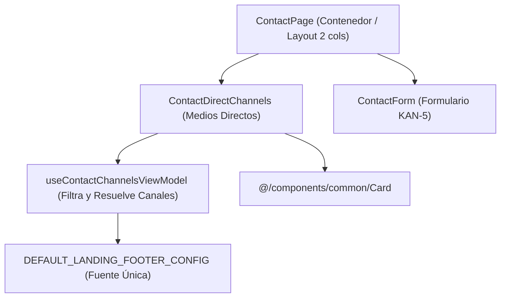

# Software Design Document (SDD) — US-17 (KAN-17)
## Medios de Contacto Directo en el Portal Landing

| Metadato | Valor |
|---|---|
| **Historia de Usuario** | US-17 / KAN-17 ("Como visitante quiero disponer de medios de contacto directo para comunicarme fácilmente con el equipo de la plataforma") |
| **Épica** | KAN-14 ([Landing] Sobre nosotros y ayuda / Contacto) |
| **Portal** | Landing (`src/modules/landing/features/contact`) |
| **Fecha de Especificación** | 2026-10-18 |
| **Estado** | Aprobada para Implementación |
| **Requerimientos Relacionados** | RF-01 (Landing Page), RNF-01 (Rendimiento), RNF-04 (Usabilidad), RNF-05 (Tema Dinámico), RNF-08 (Accesibilidad WCAG AA) |

---

### 1. Resumen y Propósito

Enriquecer la página de contacto (`ContactPage`) bajo la ruta `/contact` (`ROUTE_PATH.LANDING.CONTACT`) incorporando una sección dedicada y accesible para los medios de contacto directo (`ContactDirectChannels` / `ContactInfoCard`). Esta sección expone de manera clara y accesible los canales oficiales de comunicación del equipo de Booking System: correo electrónico (`mailto:`), teléfono de atención (`tel:`) y enlaces a redes sociales oficiales (Facebook, Instagram, LinkedIn, X con apertura en nueva pestaña y `rel="noopener noreferrer"`), reutilizando la fuente de configuración canónica de la plataforma (`DEFAULT_LANDING_FOOTER_CONFIG`).

La interfaz se organiza en un diseño responsivo de dos columnas en pantallas de escritorio (información de contacto y medios directos a la izquierda, formulario validado con reCAPTCHA KAN-5 a la derecha) y se apila de forma vertical en dispositivos móviles sin scroll horizontal.

---

### 2. Criterios de Aceptación Medibles

* **AC-KAN-17-01 [Happy Path - Visualización de Canales Directos]:** Dado que existen datos de contacto configurados, cuando un visitante accede a `/contact`, entonces se visualizan:
  - Enlace accesible de correo electrónico con protocolo `mailto:`.
  - Enlace accesible de teléfono con protocolo `tel:`.
  - Enlaces a redes sociales oficiales con apertura en nueva pestaña (`target="_blank"` y `rel="noopener noreferrer"`).
* **AC-KAN-17-02 [Happy Path - Integración con Formulario de Contacto]:** En la misma página `/contact`, se visualiza de forma conjunta el formulario de contacto interactivo de KAN-5 con su validación por Zod y verificación de reCAPTCHA.
* **AC-KAN-17-03 [Edge - Omisión de Canales no Configurados]:** Si un canal de contacto (p. ej., teléfono o una red social específica) no cuenta con valor configurado o está vacío, dicho elemento se omite por completo del DOM, sin generar etiquetas vacías ni enlaces rotos.
* **AC-KAN-17-04 [Edge - Modo Formulario Exclusivo]:** Si ningún canal directo está disponible, la página muestra únicamente el formulario con la indicación accesible correspondiente sin desconfigurar la maquetación.
* **AC-KAN-17-05 [Accesibilidad WCAG AA y Theming (RNF-05, RNF-08)]:**
  - Todos los enlaces disponen de nombres accesibles claros (`aria-label`) describiendo el destino o la acción.
  - Indicadores de foco visibles por teclado (`focus-visible:ring-2`).
  - Empleo exclusivo de tokens semánticos de Tailwind v4 (`bg-card`, `text-card-foreground`, `text-muted-foreground`, `border-border`).
  - Responsive y usable en viewports estrechos (360 px) sin desbordamiento.
* **AC-KAN-17-06 [Internacionalización]:** Claves añadidas en `landing.json` (`contact.channels.*` y `contact.page.*`) en inglés y español, ordenadas alfabéticamente.

---

### 3. Matriz de Fronteras de Equipo

| Recurso / Módulo | Estado | Permiso |
|---|---|---|
| `docs/specs/2026-10-18-US-17-medios-contacto-directo-landing.md` | Nuevo archivo | **Permitido (Creador)** |
| `src/modules/landing/features/contact/components/ContactDirectChannels.tsx` | Nuevo componente | **Permitido (Creador)** |
| `src/modules/landing/features/contact/components/ContactDirectChannels.types.ts` | Nuevo archivo | **Permitido (Creador)** |
| `src/modules/landing/features/contact/ContactPage.tsx` | Componente actualizado con layout de 2 columnas | **Permitido (Creador)** |
| `src/modules/landing/features/contact/constants/contactChannels.constants.ts` | Constantes ordenadas A-Z con `Object.freeze` | **Permitido (Creador)** |
| `src/modules/landing/features/contact/hooks/useContactChannelsViewModel.ts` | Hook MVVM para resolver canales activos | **Permitido (Creador)** |
| `src/modules/landing/features/contact/tests/ContactDirectChannels.test.tsx` | Pruebas unitarias de canales directos | **Permitido (Creador)** |
| `src/modules/landing/features/contact/tests/ContactPage.test.tsx` | Pruebas de integración de la página | **Permitido (Creador)** |
| `src/i18n/locales/{es,en}/landing.json` | Claves bajo `contact.channels.*` | **Permitido (Aditivo)** |
| `src/components/common/**` | Átomos UI (`Card`, `Button`, `Badge`) | **Solo Lectura / Consumo** |
| Otros módulos | Fuera de alcance | **PROHIBIDO MODIFICAR** |

---

### 4. Arquitectura de Componentes y Estado (MVVM)

---

### 5. Plan de Verificación de Calidad

1. **Prettier:** `npm run format:check` con 0 inconsistencias de formato.
2. **TypeScript:** `npm run typecheck` (`tsc -b --noEmit`) sin errores de compilación ni tipos `any`.
3. **ESLint:** `npm run lint` con 0 errores y 0 advertencias.
4. **Vitest:** Pruebas unitarias y de integración cubriendo el 100% de `AC-KAN-17-01` a `AC-KAN-17-06`.
