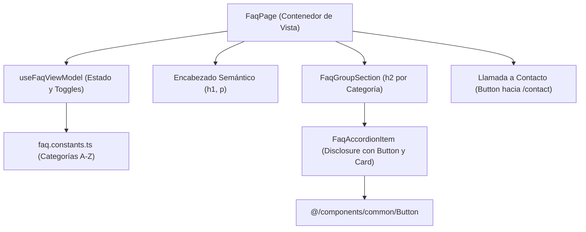

# Software Design Document (SDD) — US-18 (KAN-18)
## Preguntas Frecuentes (FAQ) en el Portal Landing

| Metadato | Valor |
|---|---|
| **Historia de Usuario** | US-18 / KAN-18 ("Como visitante quiero consultar una sección de preguntas frecuentes para encontrar respuestas rápidas a dudas comunes") |
| **Épica** | KAN-14 ([Landing] Sobre nosotros y ayuda / Contacto) |
| **Portal** | Landing (`src/modules/landing/features/faq`) |
| **Fecha de Especificación** | 2026-10-18 |
| **Estado** | Aprobada para Implementación |
| **Requerimientos Relacionados** | RF-01 (Landing Page), RNF-01 (Rendimiento), RNF-04 (Usabilidad), RNF-05 (Tema Dinámico), RNF-08 (Accesibilidad WCAG AA) |

---

### 1. Resumen y Propósito

Proveer en el portal público de Booking System una página dedicada, accesible y organizada para la consulta de Preguntas Frecuentes (`FaqPage`) bajo la ruta `/faq` (`ROUTE_PATH.LANDING.FAQ`). Esta vista permite a visitantes, potenciales suscriptores y clientes resolver de forma ágil y autónoma dudas recurrentes sobre el funcionamiento de la plataforma, la gestión de citas y los planes de suscripción.

La página implementa el patrón de revelación accesible (*disclosure/accordion*), agrupa las dudas por categorías temáticas semánticas, asegura operabilidad integral por teclado (`Tab`, `Enter`, `Espacio`, atributos `aria-expanded` y `aria-controls`), se adapta responsivamente a temas claro y oscuro mediante tokens de Tailwind v4 y enlaza fluidamente con el formulario de contacto para consultas no resueltas.

---

### 2. Criterios de Aceptación Medibles

* **AC-KAN-18-01 [Happy Path - Despliegue y Colapso Interactivo]:** Dado que existen preguntas frecuentes, cuando un visitante activa una pregunta mediante clic o teclado, entonces se expande su respuesta y el botón refleja `aria-expanded="true"`; al activarlo nuevamente, se colapsa y refleja `aria-expanded="false"`.
* **AC-KAN-18-02 [Happy Path - Agrupación Semántica por Categoría]:** Dado que las preguntas están organizadas por temas (p. ej., Servicios y Reservas, Planes y Pagos, Cuenta y Seguridad), cuando se renderiza la vista, cada categoría cuenta con su propio encabezado semántico (`<h2>`) y agrupa sus respectivas preguntas.
* **AC-KAN-18-03 [Edge - Omisión de Preguntas sin Respuesta]:** Dado que una entrada contiene pregunta pero carece de respuesta en el idioma activo, cuando se procesa el listado, dicha entrada es omitida para no presentar bloques vacíos.
* **AC-KAN-18-04 [Edge - Estado Vacío o Redirección a Contacto]:** Dado que no existan entradas en el catálogo de FAQ (o tras aplicar filtros/idioma), se presenta un mensaje accesible (`landing:faq.empty`) junto con una llamada a la acción hacia la página de contacto (`/contact`).
* **AC-KAN-18-05 [Accesibilidad WCAG AA y Navegación por Teclado (RNF-08)]:** Cada elemento disparador es un componente `Button` alcanzable con `Tab`, operable con `Enter` y `Espacio`, con indicador de foco visible y atributos de accesibilidad (`aria-expanded`, `aria-controls`) sincronizados con la visibilidad de la respuesta.
* **AC-KAN-18-06 [Internacionalización y Theming (RNF-05)]:** Textos 100% traducidos en `landing.json` (`faq.*`) en español e inglés, respetando el orden alfabético estricto de claves y consumiendo tokens semánticos de Tailwind v4 (`bg-card`, `text-card-foreground`, `text-muted-foreground`, `border-border`).

---

### 3. Matriz de Fronteras de Equipo

| Recurso / Módulo | Estado | Permiso |
|---|---|---|
| `docs/specs/2026-10-18-US-18-preguntas-frecuentes-landing.md` | Nuevo archivo | **Permitido (Creador)** |
| `src/modules/landing/features/faq/FaqPage.tsx` | Nuevo componente | **Permitido (Creador)** |
| `src/modules/landing/features/faq/components/FaqAccordionItem.tsx` | Nuevo componente | **Permitido (Creador)** |
| `src/modules/landing/features/faq/components/FaqGroupSection.tsx` | Nuevo componente | **Permitido (Creador)** |
| `src/modules/landing/features/faq/components/index.ts` | Exportación barrel componentes | **Permitido (Creador)** |
| `src/modules/landing/features/faq/constants/faq.constants.ts` | Constantes congeladas A-Z | **Permitido (Creador)** |
| `src/modules/landing/features/faq/models/faq.model.ts` | Interfaces y tipos TypeScript | **Permitido (Creador)** |
| `src/modules/landing/features/faq/hooks/useFaqViewModel.ts` | Hook MVVM | **Permitido (Creador)** |
| `src/modules/landing/features/faq/tests/FaqPage.page.ts` | Page Object Model | **Permitido (Creador)** |
| `src/modules/landing/features/faq/tests/FaqPage.test.tsx` | Pruebas de integración del componente | **Permitido (Creador)** |
| `src/modules/landing/features/faq/tests/useFaqViewModel.test.tsx` | Pruebas unitarias del ViewModel | **Permitido (Creador)** |
| `src/modules/landing/features/faq/index.ts` | Exportación barrel del feature | **Permitido (Creador)** |
| `src/constants/routes/RoutePath.constants.ts` | Adición de `ROUTE_PATH.LANDING.FAQ` (`/faq`) | **Permitido (Aditivo)** |
| `src/modules/landing/landing.routes.tsx` | Registro de ruta lazy `/faq` | **Permitido (Aditivo)** |
| `src/i18n/locales/{es,en}/landing.json` | Claves bajo `faq.*` | **Permitido (Aditivo)** |
| `src/components/common/**` | Átomos UI (`Card`, `Button`, `EmptyState`) | **Solo Lectura / Consumo** |
| Otros módulos | Fuera de alcance | **PROHIBIDO MODIFICAR** |

---

### 4. Arquitectura de Componentes y Estado (MVVM)

---

### 5. Plan de Verificación de Calidad

1. **Prettier:** `npm run format:check` con 0 inconsistencias de formato.
2. **TypeScript:** `npm run typecheck` (`tsc -b --noEmit`) sin errores de compilación ni tipos `any`.
3. **ESLint:** `npm run lint` con 0 errores y 0 advertencias.
4. **Vitest:** `vitest run src/modules/landing/features/faq/` cubriendo los criterios `AC-KAN-18-01` a `AC-KAN-18-06` con POM.
