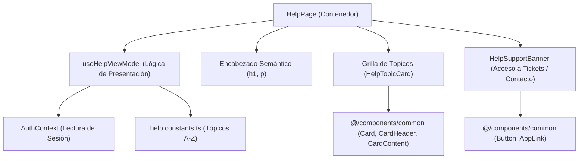

# Software Design Document (SDD) — US-19 (KAN-19)
## Sección de Ayuda y Soporte Técnico en el Portal Landing

| Metadato | Valor |
|---|---|
| **Historia de Usuario** | US-19 / KAN-19 ("Como visitante quiero acceder a una sección de ayuda para recibir orientación y soporte técnico sobre el sistema") |
| **Épica** | KAN-14 ([Landing] Sobre nosotros y ayuda / Contacto) |
| **Portal** | Landing (`src/modules/landing/features/help`) |
| **Fecha de Especificación** | 2026-10-18 |
| **Estado** | Aprobada para Implementación |
| **Requerimientos Relacionados** | RF-01 (Landing Page), RNF-01 (Rendimiento), RNF-04 (Usabilidad), RNF-05 (Tema Dinámico), RNF-08 (Accesibilidad WCAG AA) |

---

### 1. Resumen y Propósito

Proveer en el portal público de Booking System una sección dedicada, accesible y estructurada de ayuda y orientación técnica (`HelpPage`) bajo la ruta `/help` (`ROUTE_PATH.LANDING.HELP`). Esta vista brinda a cualquier visitante o cliente potencial guías rápidas sobre el funcionamiento de la plataforma (primeros pasos, configuración de agenda, gestión de suscripciones), canalizando dudas hacia las Preguntas Frecuentes (`FAQ`), el formulario y canales de contacto directo (`/contact`), y permitiendo a los suscriptores autenticados acceder de forma directa al soporte técnico mediante tickets en su portal.

La sección se integra armónicamente en el `LandingLayout` (compartiendo la barra de navegación y el pie de página), soporta internacionalización completa (`es` y `en`) y garantiza cumplimiento riguroso de accesibilidad y tokens de diseño dinámico en Tailwind CSS v4.

---

### 2. Criterios de Aceptación Medibles

* **AC-KAN-19-01 [Happy Path - Visualización de Tópicos y Canales de Ayuda]:** Dado que un visitante navega a `/help`, cuando se renderiza la vista, entonces se visualizan:
  - Título principal (`<h1>`) y descripción general orientativa (`landing:help.page.title`, `landing:help.page.description`).
  - Tarjetas de tópicos y guías rápidas organizadas semánticamente (Primeros pasos, Configuración de agenda, Pagos y suscripciones).
  - Enlace destacado hacia la sección de Preguntas Frecuentes (`/faq` o sección correspondiente).
  - Enlace directo hacia la página de contacto (`/contact`).
* **AC-KAN-19-02 [Happy Path - Acceso a Soporte Técnico para Suscriptores]:** Dado que un usuario con sesión activa de suscriptor (`SUBSCRIBER`) accede a la sección de ayuda, cuando se renderiza la vista, entonces se muestra una tarjeta o llamada a la acción contextual para abrir tickets de soporte técnico (`landing:help.supportTicket.title` y acción hacia el portal de negocio).
* **AC-KAN-19-03 [Edge - Visitante Público o No Suscriptor]:** Dado que un visitante que no ha iniciado sesión (o un usuario sin rol de suscriptor) accede a `/help`, entonces la llamada a la acción de tickets de soporte técnico privados no se muestra, promoviendo en su lugar el canal de contacto público.
* **AC-KAN-19-04 [Accesibilidad WCAG AA y Dynamic Theming (RNF-05, RNF-08)]:**
  - Uso de encabezados semánticos jerárquicos (`<h1>`, `<h2>`, `<h3>`).
  - Elementos interactivos enfocables por teclado con indicadores de foco visibles.
  - Consumo exclusivo de tokens de color semánticos de Tailwind v4 (`bg-card`, `text-card-foreground`, `text-foreground`, `text-muted-foreground`, `border-border`).
  - Adaptabilidad total a viewports móviles (360 px) sin scroll horizontal.
* **AC-KAN-19-05 [Internacionalización]:** Todos los textos de la página, tópicos, títulos y llamadas a la acción residen en `landing.json` (`help.*`) para español e inglés, respetando el orden alfabético estricto de claves.

---

### 3. Matriz de Fronteras de Equipo

| Recurso / Módulo | Estado | Permiso |
|---|---|---|
| `docs/specs/2026-10-18-US-19-seccion-ayuda-landing.md` | Nuevo archivo | **Permitido (Creador)** |
| `src/modules/landing/features/help/HelpPage.tsx` | Nuevo componente | **Permitido (Creador)** |
| `src/modules/landing/features/help/components/HelpTopicCard.tsx` | Nuevo componente | **Permitido (Creador)** |
| `src/modules/landing/features/help/components/HelpSupportBanner.tsx` | Nuevo componente | **Permitido (Creador)** |
| `src/modules/landing/features/help/components/index.ts` | Exportación barrel componentes | **Permitido (Creador)** |
| `src/modules/landing/features/help/constants/help.constants.ts` | Constantes ordenadas A-Z con `Object.freeze` | **Permitido (Creador)** |
| `src/modules/landing/features/help/models/help.model.ts` | Interfaces y tipos del ViewModel y componentes | **Permitido (Creador)** |
| `src/modules/landing/features/help/hooks/useHelpViewModel.ts` | Hook MVVM | **Permitido (Creador)** |
| `src/modules/landing/features/help/tests/HelpPage.page.ts` | Page Object Model | **Permitido (Creador)** |
| `src/modules/landing/features/help/tests/HelpPage.test.tsx` | Pruebas de integración del componente | **Permitido (Creador)** |
| `src/modules/landing/features/help/tests/useHelpViewModel.test.tsx` | Pruebas unitarias del ViewModel | **Permitido (Creador)** |
| `src/modules/landing/features/help/index.ts` | Exportación barrel del feature | **Permitido (Creador)** |
| `src/constants/routes/RoutePath.constants.ts` | Adición de `ROUTE_PATH.LANDING.HELP` (`/help`) | **Permitido (Aditivo)** |
| `src/modules/landing/landing.routes.tsx` | Registro de ruta lazy `/help` | **Permitido (Aditivo)** |
| `src/i18n/locales/{es,en}/landing.json` | Claves bajo `help.*` | **Permitido (Aditivo)** |
| `src/components/common/**` | Átomos UI (`Card`, `Button`, `Badge`) | **Solo Lectura / Consumo** |
| Otros módulos | Áreas fuera del scope | **PROHIBIDO MODIFICAR** |

---

### 4. Arquitectura de Componentes y Estado (MVVM)

---

### 5. Plan de Verificación de Calidad

1. **Prettier:** `npm run format:check` con 0 inconsistencias de formato.
2. **TypeScript:** `npm run typecheck` (`tsc -b --noEmit`) sin errores de compilación ni casts `any`.
3. **ESLint:** `npm run lint` con 0 errores y 0 advertencias.
4. **Vitest:** `vitest run src/modules/landing/features/help/` con cobertura del 100% de los criterios `AC-KAN-19-01` a `AC-KAN-19-05` mediante Page Object Model.
